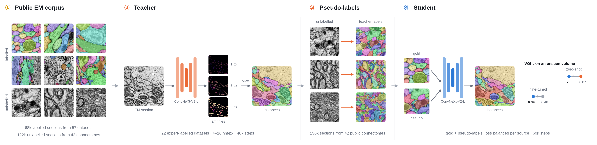
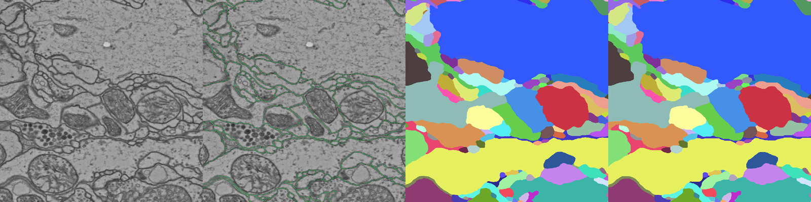

# 🧠 EM-Seg

**Teacher–student pseudo-label pretraining for dense 2D instance segmentation of electron microscopy (EM).**

Every cell profile in a section gets its own id. A network predicts a foreground map and affinities at 1 / 3 / 9 / 27 px,
a mutex watershed turns them into instances. A large **teacher** is trained on 22 public, expert-labelled datasets; it
labels ~130 k unlabelled sections cut from public connectomes; a **student** learns from gold labels and pseudo-labels
together. Everything here is reproducible from public data with one command per stage.

<p align="center"></p>

## ✨ What is in the box

| part | what it does | read more |
|---|---|---|
| 📦 `emseg/data/` | builds the labelled corpus from 30 public EM releases: download with checksums → one standard → QA → de-duplication → leakage scan → manifests (57 datasets, 68 k sections, gold / silver labels); streams the unlabelled pool (122 k raw sections) from 42 public connectomes | [emseg/data/README.md](emseg/data/README.md) |
| 🧑‍🏫 🏷️ 🎓 `emseg/train/`, `emseg/models/`, `emseg/{pseudolabel,finetune,probe}.py` | teacher training, offline pseudo-labelling, student training, zero-shot evaluation, fine-tuning, frozen-feature probes | [docs/training.md](docs/training.md) |
| 📏 `emseg/eval/`, `emseg/seg/` | the evaluation protocol: VOI, ARAND, mSA, F1 / PQ, error classes; benchmark loaders and splits; affinity targets and mutex-watershed decoding | [docs/evaluation.md](docs/evaluation.md) |
| 🚀 `scripts/` | one resumable command per stage (`10_` data … `60_` figures) | this page |
| 🧰 `tools/` | detached jobs with memory caps, auto-resume, pseudo-label statistics and figures | [tools/README.md](tools/README.md) |
| 📈 `docs/` | results tables and the overview figure (`overview.png` / `.pdf`) | [docs/results.md](docs/results.md) |

## 🗺️ Repository map

```
EM-Seg/
├── emseg/                      the package (pip install -e . or PYTHONPATH=<repo>)
│   ├── data/                   corpus construction (data environment, no torch)
│   │   ├── registry.py         every public source: URLs, checksums, licence, converter, leakage rules — the single source of truth
│   │   ├── standard.py         the EMDATA-v2 file standard and the writers used by all converters
│   │   ├── pipeline.py         runs the stages in order:  python -m emseg.data.pipeline all
│   │   ├── stages/             download · provenance · convert · qa · dedup · manifest · report (+ datacard) · export_hf
│   │   ├── converters/         downloaded (http releases) · benchmarks (SNEMI/CREMI/Lucchi/EMNeuron) · stream (connectomes) · asem · coco
│   │   └── unlab.py            unlabelled pool from public connectome volumes
│   ├── eval/                   protocol: metrics · gt · evaluate · errclass · cli (emseg-eval) · domains/{snemi,cremi,mouse30um}
│   ├── seg/                    primitives: targets (affinity offsets, grids) · mws (decoding) · crops · unet · lsd · prior · superpixels
│   ├── models/                 pretrainnet (ConvNeXt-V2 + full-res FPN + heads) · features (frozen extractors)
│   ├── train/                  data (crop sampler over corpus + pseudo-labels) · relations (pair targets, contrastive loss) · teacher_student (trainer)
│   ├── pseudolabel.py  finetune.py  probe.py  evalsuite.py      entry points:  python -m emseg.<name>
│   └── paths.py                EMDATA_ROOT / RUNS_ROOT / EM2DSEG_DATA_ROOT resolution
├── scripts/                    00_setup_envs 10_build_corpus 11_build_unlab_pool 12_get_benchmarks 20_train_teacher 30_pseudolabel 40_train_student 50_evaluate 60_visualize env.sh
├── tools/                      detach.sh status.sh keepalive.sh (jobs) · pdl.py (downloader) · pseudo_stats.py pseudo_vis.py vis_predictions.py label_audit.py
├── configs/                    unlab_sources_public.json (36 public volumes of the pool, with licences)
├── tests/                      unit tests (metrics, targets, splits, loaders, data writers) — no data needed
├── envs/                       train.yml  data.yml
├── docs/                       overview.png/.pdf · results.md · training.md · evaluation.md · example_cremiB.png
└── pyproject.toml  LICENSE  README.md
```

Dependencies between subpackages are one-directional: `eval` → `paths`; `seg` → `eval`; `models` → `seg`; `train` → `models`,
`seg`; the entry modules `pseudolabel` / `finetune` / `probe` sit on top of them. `data` stands alone (it only imports
`eval.domains` lazily for the benchmark leakage scan), so the data environment never needs torch.

Everything that is not code lives outside git: `data/` (corpus, pool, pseudo-labels, benchmarks) and `runs/` (one directory
per training or evaluation run). Both locations are set by two environment variables (next section).

---

## ⚙️ 1. Setup

**Hardware.** Training was done on 2 × 96 GB GPUs (batch 16 per GPU, ~43 GB each for the ConvNeXt-V2-L teacher). Smaller
GPUs work with a smaller `--batch` (the learning rate is scaled by the global batch automatically). Data building is CPU and
network bound; plan for ~300 GB of disk (90 GB raw downloads, 40 GB converted corpus, 106 GB pool, 35 GB per pseudo-label pass).

**Environments.** Two conda environments keep the heavy data stack (cloud-volume, zarr, datasets) away from the training stack
(`pyproject.toml` lists the same dependencies as extras `[train]` / `[data]` if you prefer pip):

```bash
git clone https://github.com/Zhou-Weichen/EM-Seg.git && cd EM-Seg
bash scripts/00_setup_envs.sh          # creates em2d-train (torch, timm, python-elf, torch_em) and em2d-data (cloud-volume, zarr, datasets)
```

If you prefer pip, the training code needs `torch timm python-elf torch_em h5py pandas scipy scikit-image tifffile`
(tested with Python 3.14, torch 2.13, timm 1.0.29, python-elf 0.9.2, torch_em 0.10.4; any torch ≥ 2.4 should do).

**Roots and paths.** Every script sources `scripts/env.sh`, which sets

| variable | default | meaning |
|---|---|---|
| `EMDATA_ROOT` | `<repo>/data` | corpus (`em/`, `em2d/`, `manifests/`), pool (`unlab/`), pseudo-labels (`pseudo/`), benchmarks (`benchmarks/`) |
| `RUNS_ROOT` | `<repo>/runs` | one directory per run: `config.json`, `log.jsonl`, `ckpt/`, `pred/`, `done.json` |
| `EM2DSEG_DATA_ROOT` | `$EMDATA_ROOT/benchmarks` | SNEMI / CREMI volumes used for evaluation and fine-tuning |
| `PYTHON` | `python` | interpreter of the active environment |

Point them at a large disk before the first run, e.g. `export EMDATA_ROOT=/mnt/fast/em2d/data RUNS_ROOT=/mnt/fast/em2d/runs`.
When you call the Python modules directly (not through `scripts/`), run `source scripts/env.sh` first: it also sets
`PYTHONPATH` so that `python -m emseg.…` works from anywhere (or `pip install -e .` once).

**Check.**

```bash
conda activate em2d-train && source scripts/env.sh
python -c "import torch, timm, elf, torch_em; print(torch.__version__, torch.cuda.is_available())"
python -m unittest discover -s tests                     # 32 tests: metrics, targets, splits, loaders, data writers
```

---

## 📦 2. Data

Two ways to get the data; both end in the same layout under `$EMDATA_ROOT`.

**🛠️ Route A – build it from the public releases** (the reference; every byte is traceable to a public URL):

```bash
conda activate em2d-data && source scripts/env.sh
tools/detach.sh DATA-corpus scripts/10_build_corpus.sh      # 30 releases → 57 datasets; resumable; a day or more (throttled hosts)
tools/detach.sh DATA-pool   scripts/11_build_unlab_pool.sh  # 42 connectomes → 122 k unlabelled sections; ~1 day
scripts/12_get_benchmarks.sh                                # SNEMI AC4/AC3 + CREMI B for evaluation (0.9 GB)
tools/status.sh DATA-corpus                                 # progress; also $EMDATA_ROOT/STATUS.md
```

**📬 Route B – ask us for the processed corpus.** The converted corpus is mirrored in a private Hugging Face dataset
(Parquet, three licence-tiered configs); the HDF5 layout that this code reads, the pseudo-labels and the pool can be shared
on request as well. See [emseg/data/README.md § B](emseg/data/README.md#b-get-the-processed-corpus-from-us).

What you should have afterwards:

| path | contents |
|---|---|
| `$EMDATA_ROOT/manifests/em_only.csv` | one row per labelled EM section: file, z, size, pixel size, classes, quality, split, sampling weight |
| `$EMDATA_ROOT/manifests/unlab.csv` | one row per raw pool section (same columns, no classes) |
| `$EMDATA_ROOT/em/<dataset>/<volume>.h5`, `em2d/<dataset>/shard_*.h5` | uint8 `raw`, `labels/<class>`, `masks/<class>` |
| `$EMDATA_ROOT/unlab/unlab_<source>/slab_*.h5` | raw 4 × 1024² slabs |
| `$EMDATA_ROOT/benchmarks/{snemi,cremi}/` | evaluation volumes |

The in-house target volume used in our paper-style numbers is not public; all commands below work without it.

---

## 🧑‍🏫 3. Train the teacher

ConvNeXt-V2-L (ImageNet-22k initialisation) with a full-resolution FPN decoder, trained on the 22 gold datasets that passed
the label audit (`tools/label_audit.py`), with a masked BCE + Dice loss on foreground + 8 affinities and a supervised
contrastive loss on sampled points. Crops are drawn at a random physical pixel size in 4–16 nm so one network serves all
resolutions.

```bash
conda activate em2d-train && source scripts/env.sh
GPUS=0,1 tools/detach.sh teacher-L-gt22 scripts/20_train_teacher.sh teacher-L-gt22      # 40k steps, ~16 h on 2 × 96 GB
tools/status.sh teacher-L-gt22                                                          # it 100 loss … 24.1 img/s
```

Outputs: `$RUNS_ROOT/teacher-L-gt22/ckpt/step_0{05,10,…,40}000.pt` (model + args, 790 MB each), `ckpt/last.pt` (resumable),
`config.json` (dataset list, rows per dataset, effective lr), `log.jsonl`. Resume after an interruption with the same command
plus `--resume $RUNS_ROOT/teacher-L-gt22/ckpt/last.pt`, or let `tools/keepalive.sh` do it automatically (§ 8).

---

## 🏷️ 4. Pseudo-label the pool

The teacher predicts affinities on every pool section (rescaled to ~8 nm/px, 1024² tiles), a mutex watershed turns them into
instances, and a per-section statistics file lets the student drop empty or degenerate sections (resin, noise, one segment).

```bash
GPUS=0,1,2 scripts/30_pseudolabel.sh $RUNS_ROOT/teacher-L-gt22/ckpt/step_040000.pt T40k    # 3 shards in parallel, 4–5 h, 35 GB
scripts/60_visualize.sh pseudo T40k                                                       # look at a few panels per dataset
```

Outputs under `$EMDATA_ROOT/pseudo/T40k/`: the same file tree as the corpus with `pseudo` (uint32 ids) and `fg` (uint8) per
section, `rows_<shard>.csv`, `stats.csv`, `config.json`. Re-running resumes (written sections are skipped).

---

## 🎓 5. Train the student

Recipe **V2-A**: a second ConvNeXt-V2-L (ImageNet-22k init) trained jointly on the 22 gold datasets (50 % of the samples) and
the pseudo-labelled pool (50 %), with the two loss terms normalised per source and the pseudo-label weight ramped up over
the first 4 k steps, 60 k steps in total.

```bash
GPUS=0,1 tools/detach.sh student-L-v2a scripts/40_train_student.sh T40k student-L-v2a      # ~25 h
```

A smaller student (ConvNeXt-V2-B initialised from the teacher, 40 k steps) is one line in the script header. Pseudo-labels
from several teacher checkpoints can be compared by running step 4 with different tags.

---

## 📊 6. Evaluate

Zero-shot: the network's own affinity head + mutex watershed, grid selected on the validation split, metrics on the test
split. Fine-tuning: 20 k iterations on the target training split, same selection and metrics.

```bash
GPUS=0 scripts/50_evaluate.sh $RUNS_ROOT/student-L-v2a/ckpt/step_060000.pt student60k            # zero-shot on SNEMI + CREMI B
GPUS=0 FINETUNE=1 scripts/50_evaluate.sh $RUNS_ROOT/teacher-L-gt22/ckpt/step_040000.pt teacher40k  # + 20k-step fine-tune per domain
```

Each run writes `done.json` (`test_summary`: `voi_sum`, `voi_split`, `voi_merge`, `arand`, `msa`, `f1_50`, `pq50`, error
classes `M1_invisible`, `M2_chain`, `S1_cut`, `S2_sliver`, …), `test_per_slice.csv`, `val_grid.json` and the test predictions
`pred/test/pred_XXXX.tif`. Any other method can be scored the same way from label images:

```bash
python -m emseg.eval.cli evaluate --domain cremi --sample B --split test --pred-dir <dir with pred_0100.tif …> --out <dir>
```

---

## 🎨 7. Visualize

```bash
scripts/60_visualize.sh run zeroshot-student60k-cremiB         # EM | GT boundaries | GT | prediction, prediction coloured by matching GT object
scripts/60_visualize.sh pseudo T40k                            # pseudo-label panels: EM | boundaries | instances | teacher foreground
```

<p align="center"></p>

---

## 📈 Results in one glance (single seed, VOI sum ↓)

| model | SNEMI (AC3) | CREMI B | in-house target (zero-shot) | in-house target (fine-tuned 20k) |
|---|---|---|---|---|
| teacher 40k | 0.255 | 0.340 | 0.866 | 0.389 |
| student V2-A 60k | 0.280 | 0.360 | **0.748** (17/20 sections better than the teacher) | 0.391 |
| in-domain U-Net, no pretraining | 0.27 | 0.47 | – | 0.484 |

Multi-source supervised pretraining lowers the fine-tuned target VOI from 0.48 to 0.39; pseudo-labels make the student the
first model that beats its teacher zero-shot on the unseen target domain, but do not add anything after fine-tuning.
Details, paired statistics, error classes and ablations: [docs/results.md](docs/results.md).

---

## 🧰 8. Long jobs: detach, monitor, resume, memory

- `tools/detach.sh <name> <command…>` starts a command detached from your terminal, logs to `$RUNS_ROOT/<name>/logs/stdout.log`
  and, when `systemd-run` is available, caps its memory (32 GB per job, 64 GB for all jobs, no swap) so a leaking data loader
  cannot take the host down. `tools/status.sh <name>` shows whether it is alive and the log tail.
- `tools/keepalive.sh <run> <launch command…>` restarts a training run from `ckpt/last.pt` whenever its process dies
  (shared GPUs, OOM). Both trainers also accept `--resume` by hand.
- All stages are idempotent: re-running skips finished downloads, conversions and pseudo-labelled sections.

## ❓ FAQ

- **Two GPUs hang at the first NCCL collective.** `scripts/env.sh` sets `NCCL_P2P_DISABLE=1`, which fixes this on hosts with
  P2P problems; unset it if your interconnect is healthy.
- **Zenodo answers 403 / "unusual traffic".** The downloader already uses one connection and one file at a time for
  zenodo.org and an honest user agent; just re-run, it resumes.
- **Google-Drive sources are incomplete.** `gdown` quotas: NucMM-Z labels arrive partially; the converter uses what is there.
  ProbTEM is off by default for that reason.
- **cremi.org certificate errors.** Expired TLS certificate on the server; the registry passes `--insecure` and verifies the
  published sha256 instead.
- **The data loader eats RAM.** HDF5 handles are kept in a bounded LRU (32 per worker); use `--workers 3 --prefetch 2` for
  the student (one file per section in the pool) and let `tools/detach.sh` cap the job.
- **Can I use my own volume as the target domain?** Add a loader class to `emseg/eval/domains/` with `load_image`,
  `load_label`, `splits`, register it in `domains/__init__.py` and `emseg/seg/mws.py: SCHEME`; `finetune.py` and the scripts pick it up.

## 📚 Citing and licences

The code is MIT-licensed. Every dataset keeps the licence of its publisher — see the source table and the redistribution
tiers in [emseg/data/README.md](emseg/data/README.md#sources-and-licences) and cite the original publications of the data you use.
The method follows the Depth Anything V2 / V3 recipe (large teacher, pseudo-labels at scale, student) adapted to affinity-based
instance segmentation; the metrics follow the CREMI / SNEMI conventions.

## 🤝 Contact

Questions, the processed corpus, pseudo-labels or checkpoints: open an issue on this repository or e-mail the maintainer
<!-- add your address here -->.
